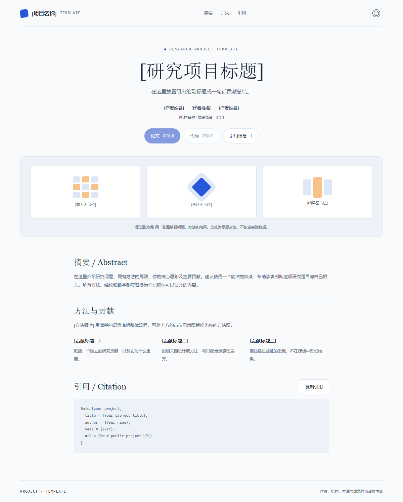

# Project Page

A small, dependency-free homepage template for open-source projects and research.

**两个布局，浅色与深色外观，零依赖。所有内容均为明确标注的占位示例。**


<details>
<summary>查看研究展示布局</summary>



</details>

## 选择一个起点

| 页面 | 适合的内容 | 布局 |
| --- | --- | --- |
| `index.html` | 开源工具、产品原型、个人项目 | 分栏首屏、项目概览、亮点、展示图、资源入口 |
| `research.html` | 论文、研究或技术成果 | 居中标题、作者与机构、概览图、摘要、贡献、可复制引用 |

- 原生 HTML、CSS、JavaScript，无构建步骤，无运行时依赖。
- 跟随系统外观，支持手动切换和保存偏好。
- 响应式布局和移动端菜单。
- 可见键盘焦点，尊重减少动态效果的系统设置。
- 未配置的外部链接显示“待添加”，避免引导用户到虚构地址。
- 不包含遥测、外部字体、追踪脚本或真实项目资料。

## 使用

直接打开 `index.html` 或 `research.html`。推荐用一个静态服务器预览：

```sh
python -m http.server 8080
```

然后访问 `http://localhost:8080`。复制引用需要安全上下文，例如 localhost 或 HTTPS；在不支持剪贴板的环境中，会选中引用供手动复制。

## 定制

1. 修改 `assets/config.js`：名称、首屏介绍、研究标题、作者、机构、亮点、链接及引用。
2. 修改 HTML 中的简介、摘要、展示标题和贡献占位内容。
3. 将 `.pht-cover-stage`、`.pht-example-visual` 或 `.pht-triptych` 的占位视觉替换为你有权公开的图片，填写准确的替代文本。图片示例：

   ```html
   
   ```

4. 在 `assets/styles.css` 顶部调整 `--pht-*` 色彩变量；`light-dark()` 的两个值分别用于浅色和深色。
5. 修改页面的 `<title>` 与 description，移除 TEMPLATE 标识，替换 footer 年份和署名。

配置中的外部链接只接受完整的 `https://` 或 `http://` 地址。链接不会请求远端接口。

## 放到 GitHub Pages

把文件放入自己的仓库，在仓库的 Settings → Pages → Build and deployment 中，选择 Deploy from a branch，再选择部署分支与根目录。默认入口是 `index.html`。若选择研究布局，可将 `research.html` 重命名为 `index.html`，保留 `assets/`。参见 [GitHub Pages 官方配置说明](https://docs.github.com/en/pages/getting-started-with-github-pages/configuring-a-publishing-source-for-your-github-pages-site)。

这是通用操作说明，模板没有绑定任何 GitHub 账号、仓库或线上服务。

## Publishing checklist

- Replace every bracketed placeholder, citation field, page title, description and footer.
- Add your public resource links; remove unused sections and unavailable links.
- Use your own screenshots and results. The included graphics are abstract placeholders, not product screenshots or research evidence.
- Review the files for private information before publishing.
- Replace the copyright owner in `LICENSE` with your own name.

## License

MIT. See [LICENSE](LICENSE). The copyright owner is intentionally left as a placeholder.
